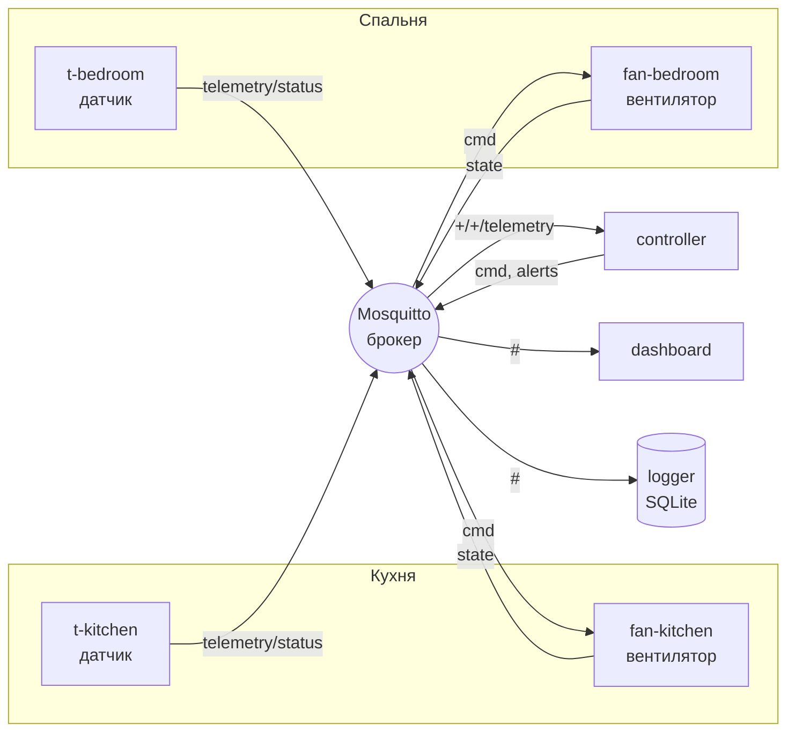

# Технічне завдання проєкту

**Дисципліна:** Програмування вбудованих систем
**Тема (№4):** Мережа вузлів на MQTT з власним брокером
**Команда:** [ПІБ 1], [ПІБ 2], [ПІБ 3], [ПІБ 4]  **Група:** [група]
**Дата:** листопад 2026

---

## 1. Підстава та призначення

Проєкт виконується як командний мікропроєкт. Його мета — створити підсистему Інтернету
речей, у якій кілька вузлів обмінюються даними через брокер повідомлень за протоколом MQTT,
і дослідити, як впливають рівні якості обслуговування (QoS) і вибір брокера (приватний чи
публічний хмарний) на надійність і затримку доставки.

Предметна область — «розумне приміщення»: датчики мікроклімату в кімнатах, вентилятори,
що ними керують, центральний контролер правил, панель моніторингу і журнал даних.

## 2. Теоретичні відомості

### 2.1. Протокол MQTT

MQTT (Message Queuing Telemetry Transport, OASIS-стандарт, версії 3.1.1 і 5.0) — легкий
протокол обміну повідомленнями за моделлю **видавець/підписник (publish/subscribe)** поверх
TCP. Він розроблений для пристроїв з обмеженими ресурсами і нестабільних каналів:
мінімальний заголовок пакета — 2 байти.

Учасники:
* **Брокер** — сервер, який приймає повідомлення і розсилає їх підписникам.
  Видавці й підписники не знають один про одного.
* **Клієнт** — будь-який вузол; може бути одночасно видавцем і підписником.
* **Топік** — ієрархічний рядок-адреса, наприклад `iot/home/kitchen/t-kitchen/telemetry`.
  Підписка підтримує шаблони: `+` — один рівень, `#` — усі нижчі рівні.

### 2.2. Рівні якості обслуговування (QoS)

| QoS | Назва | Обмін пакетами | Гарантія | Застосування |
|---|---|---|---|---|
| 0 | at most once | PUBLISH | «відправив і забув», можливі втрати | часта телеметрія, де втрата одного виміру не критична |
| 1 | at least once | PUBLISH → PUBACK | доставка гарантована, можливі дублікати | команди, статуси |
| 2 | exactly once | PUBLISH → PUBREC → PUBREL → PUBCOMP | рівно один раз | тривоги, облік, платежі |

Що вищий QoS, то більше пакетів на одне повідомлення, тож зростають затримка і навантаження.

### 2.3. Механізми надійності MQTT, які використовує проєкт

* **Retained-повідомлення** — брокер зберігає останнє повідомлення топіка і одразу надсилає
  його новому підписнику (застосовано для статусу вузла і стану виконавця).
* **Last Will and Testament (LWT)** — «заповіт», який клієнт реєструє під час підключення.
  Якщо з'єднання обірвалося без пакета DISCONNECT, брокер сам публікує це повідомлення
  (у нас це `offline` у топіку статусу).
* **Keep Alive** — період PINGREQ/PINGRESP. Якщо від клієнта нічого не приходить
  протягом 1,5 × keepalive, брокер вважає його відключеним.
* **Persistent session (`clean_session=false`)** — брокер пам'ятає підписки клієнта і
  накопичує для нього QoS1/2-повідомлення, поки той офлайн.

### 2.4. Приватний і публічний брокер

| Критерій | Публічний (хмарний) брокер | Приватний брокер |
|---|---|---|
| Розгортання | не потрібне | потрібен сервер, адміністрування |
| Затримка | залежить від Інтернету (десятки–сотні мс) | одиниці мс у локальній мережі |
| Безпека | без автентифікації, топіки бачить будь-хто | паролі, ACL, TLS |
| Надійність | без SLA, ліміти, можлива недоступність | контролюється власником |
| Призначення | прототипування, навчання | промислова експлуатація |

### 2.5. Безпека

* **Автентифікація** — логін і пароль (у Mosquitto: `password_file`, хеші PBKDF2-SHA512).
* **Авторизація (ACL)** — права на читання і запис для конкретних топіків, за принципом
  найменших привілеїв.
* **Шифрування** — MQTT поверх TLS (порт 8883). Без TLS пароль передається відкритим текстом.

## 3. Функціональні вимоги

| № | Вимога |
|---|---|
| Ф1 | Щонайменше 2 вузли-датчики, які періодично публікують температуру, вологість і тиск у форматі JSON |
| Ф2 | Щонайменше 2 вузли-виконавці (вентилятори), які приймають команди `on/off` і публікують свій стан |
| Ф3 | Контролер, який підписується на телеметрію всіх кімнат через шаблон і керує вентиляторами з гістерезисом |
| Ф4 | Тривоги: перегрів (> поріг + 5 °C) і зникнення вузла, у топіку `alerts` з QoS 2 |
| Ф5 | Панель моніторингу в реальному часі: статус вузлів, останні виміри, стан вентиляторів, тривоги |
| Ф6 | Журнал телеметрії і подій у БД SQLite |
| Ф7 | Статус вузлів через retained + LWT |
| Ф8 | Власний брокер Mosquitto у двох режимах: розробки та захищеному (пароль, ACL, TLS) |
| Ф9 | Інструмент для вимірювання доставки, дублікатів і затримки для QoS 0/1/2 |
| Ф10 | Порівняння приватного брокера з публічними (test.mosquitto.org, broker.hivemq.com, broker.emqx.io) |

## 4. Нефункціональні вимоги

* Мова — Python 3.10+, бібліотека `paho-mqtt` 2.x; брокер — Eclipse Mosquitto 2.0.
* Вся система запускається на одному ПК однією командою (`./run_demo.sh`).
* Некоректні повідомлення (не JSON, невідомі команди) не повинні ламати вузли.
* Після обриву зв'язку вузли перепідключаються автоматично.
* Конфігурація (адреса брокера, логін, TLS) задається змінними середовища.

## 5. Архітектура

### 5.1. Структура топіків

| Топік | Хто публікує | QoS | Retain | Вміст |
|---|---|---|---|---|
| `iot/<site>/<room>/<node>/telemetry` | датчик | 0 або 1 | ні | `{"node","room","seq","ts","temperature","humidity","pressure"}` |
| `iot/<site>/<room>/<node>/status` | вузол / брокер (LWT) | 1 | так | `online` / `offline` |
| `iot/<site>/<room>/<node>/cmd` | контролер | 1 | ні | `{"power":"on","reason":"t=27.1°C"}` або `{"interval":5}` |
| `iot/<site>/<room>/<node>/state` | вентилятор | 1 | так | `{"power","changed","reason"}` |
| `iot/<site>/alerts` | контролер | 2 | ні | `{"ts","level","text",...}` |

## 6. Розподіл ролей у команді

| Учасник | Зона відповідальності |
|---|---|
| [ПІБ 1] — керівник, архітектор | ТЗ, структура топіків, контролер, інтеграція, `run_demo.sh` |
| [ПІБ 2] — вузли | `sensor_node`, `actuator_node`, модель датчика, LWT/retained |
| [ПІБ 3] — брокер і безпека | конфіги Mosquitto, ACL, TLS, паролі, тести безпеки |
| [ПІБ 4] — дослідження і звіти | `qos_bench`, `compare_brokers`, панель, логер, звіти |

*(Якщо в команді 2–3 учасники, ролі 3 і 4 об'єднуються.)*

## 7. Етапи виконання

| Етап | Результат | Термін |
|---|---|---|
| 1 | Технічне завдання, вибір середовища | 09.11.2026 |
| 2 | Брокер, вузли, контролер, панель | 11.11.2026 |
| 3 | Симуляція сценаріїв, вимірювання QoS, порівняння брокерів | 12.11.2026 |
| 4 | Звіти із завдань програмування та симуляції, захист | 13.11.2026 |

## 8. Критерії приймання

1. `./run_demo.sh` запускає всю систему; панель показує 4 вузли і контролер зі статусом `online`.
2. Коли температура в кімнаті перевищує поріг, вентилятор вмикається, а коли падає нижче
   нижнього порогу — вимикається.
3. Після аварійного завершення вузла (`kill -9`) його статус змінюється на `offline`
   (через LWT), а контролер піднімає тривогу.
4. Тест офлайн-підписника: QoS 1/2 доставляють 100 % повідомлень, QoS 0 гарантій не дає.
5. Захищений брокер відхиляє анонімних клієнтів і неправильний пароль; ACL не дає вузлу
   публікувати в чужі топіки.
6. Є таблиці вимірювань для локального і публічних брокерів і висновки щодо вибору.
